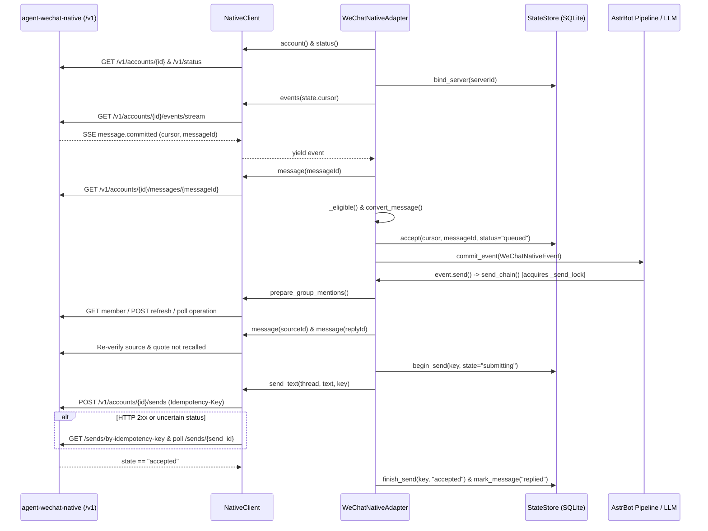

# 架构说明

[返回 README](../README.md) | [图片识别实现说明](image-recognition.md)

本页说明 `astrbot-plugin-wechat-native` 的进程边界、状态机、事件流向与代码结构，供开发与排障参考。安装配置见 [README](../README.md)，回执排障见 [运维说明](operations.md)，图片识别细节见 [图片识别实现说明](image-recognition.md)。

## Overview

`astrbot-plugin-wechat-native` 是 AstrBot 的进程内个人微信平台适配器插件。插件本身不实现腾讯微信私有协议或扫码登录流程，而是通过 HTTP 与 SSE 连接外部独立守护进程 `agent-wechat-native v2.3.0` 的 `/v1` 接口。外部守护进程维护微信登录态、协议收发与群成员缓存。本插件负责事件拉取、状态幂等持久化、撤回联动拦截与可验证的消息投递。

核心设计目标是至多一次的自动回复投递与零敏感信息落盘。插件使用本地 SQLite 状态库记录游标和消息回执状态，不在数据库或异常日志中保存 Token、URL 或聊天正文。当进程崩溃或网络超时导致投递状态不确定时，插件会将消息锁定为待人工检查状态，禁止自动重发。

## Key concepts

* **外部边车守护进程**。`NativeClient`（[`native_client.py`](../native_client.py)）访问 `agent-wechat-native` 提供的 REST 与 SSE 接口。所有请求禁用 HTTP 重定向与系统环境变量代理，剥离响应体细节，仅将错误码映射至固定白名单 `_SAFE_CODES`。
* **无正文事务日志**。`StateStore`（[`state.py`](../state.py)）管理开启 `WAL` 和 `synchronous=FULL` 的 SQLite 数据库，文件权限设为 `0o600`。它仅存储单调递增的 SSE 游标 `checkpoint`、服务端身份 `settings['server_id']`、消息状态表 `messages`、撤回墓碑表 `recalls` 和发送回执表 `sends`。
* **双身份隔离**。AstrBot 的 `PlatformManager` 占用 `self.client_self_id` 存储平台实例任务 UUID。`WeChatNativeAdapter.__init__`（[`adapter.py`](../adapter.py)）将微信账号的真实身份单独保存在 `self.bot_self_id` 中，并在 `WeChatNativeAdapter.run` 连接成功后更新为 `ownUsername`。
* **发送前二次核验**。在大模型生成回复期间，原消息或被引用消息可能已被撤回。`WeChatNativeAdapter.send_chain` 在发起发送请求前，会重新向 Native 服务端拉取源消息与引用目标消息，并复核内存摘要缓存，防止针对已撤回内容发出回复。
* **幂等键与只读轮询**。每次外发消息在 `send_chain` 中生成唯一 `astrbot-<uuid4>` 幂等键并写入 `sends` 表。若 `NativeClient.send_text` 遇到超时、断连、`408`、`429` 或 `5xx`，客户端不再重复提交 `POST`，而是通过 `/sends/by-idempotency-key` 查询回执并轮询 `/sends/{send_id}` 直到状态变为 `accepted`。

## How it works

### 1. 启动、配置加载与崩溃恢复

当 AstrBot 导入插件包时，[`main.py`](../main.py) 导入 `WeChatNativeAdapter` 并触发 `@register_platform_adapter` 完成平台注册。`WeChatNativePlugin.__init__` 同时挂载 `/astrbot_plugin_wechat_native/connection/bots` 与 `/astrbot_plugin_wechat_native/connection/check` 两个只读 Web 路由。

适配器实例化时，`NativeConfig.from_dict`（[`config.py`](../config.py)）校验配置字典，自动为 `server_url` 补全 `/v1` 后缀，并通过 `load_token` 从文件或配置读取长度不超过 8192 字节的可打印 ASCII Token。随后 `WeChatNativeAdapter.__init__` 根据 `api_url`、`account_id` 和实例 `id` 的 SHA-256 摘要打开专属 `StateStore`。

`StateStore` 在初始化事务中立即执行崩溃自检。任何上次进程退出时仍处于 `queued` 的消息或处于 `submitting` 的发送记录都会转为 `needs_review`。若消息已标记为 `replied` 但存在未 `accepted` 的发送分片，状态会降级为 `partial`，阻断崩溃后的重复自动投递。

### 2. SSE 事件流与入站管线

`WeChatNativeAdapter.run` 维护主事件循环。每次建立连接时，它依次调用 `client.account()` 核对账号 ID，调用 `client.status()` 获取 `serverId`，并调用 `state.bind_server()` 绑定服务端身份。若服务端 `serverId` 发生变更，插件抛出 `StateIdentityError` 停止消费以保护游标现场。

接着适配器调用 `client.events(self.state.cursor)` 订阅 `/accounts/{id}/events/stream`。SSE 解析器跳过以冒号开头的心跳注释，限制单帧不超过 1 MiB，并在校验游标单调性后交由 `process_native_event` 处理：

* **撤回事件 `message.recalled`**。`process_native_event` 调用 `state.recall()` 写入撤回墓碑并将对应消息标为 `recalled`，同时从 `summary_cache.recall()` 中剔除该记录。随后遍历当前活跃的 `_events` 弱引用字典。若正在处理的事件本身被撤回，直接调用 `active.stop_event()` 并取消在途媒体下载任务。若正在处理的事件引用了这封被撤回的消息，则设置 `wechat_native_quote_invalidated = True`、终止事件、取消在途媒体下载任务并将 `queued` 状态标为 `no_reply`。
* **新消息事件 `message.committed`**。由于 SSE 帧不包含消息正文，`process_native_event` 调用 `client.message(message_id)` 拉取完整消息并校验 `id`、`accountId` 与 `threadId`。随后通过 `_classify` 将消息分为 `"ignore"`、`"text"` 或 `"media"`。准入条件要求满足 `origin == "live"`、`direction == "incoming"`、未被撤回、非机器人自身发送、时间戳偏差在 `-60s` 至 `+300s` 之间，且符合私聊或群聊白名单与触发模式。开启 `enable_media` 时，私聊直接发图（`type == 3`）、私聊引用图片（`type == 49, appMessageType == 57, quote.type == 3`）以及群聊引用图片并真正 `@` 机器人会进入 `"media"` 异步下载管线，其余非文本富媒体被过滤丢弃。
* **格式转换与入队移交**。`convert_message`（[`event.py`](../event.py)）将原始字典转为 `AstrBotMessage`。当群消息明确 `@` 机器人时，即 `mentions.state == "known"` 且 `mentions.self is True`，正则会剥离正文前导的 `@昵称\u2005` 标签。同时在组件列表头部注入合成的 `At(qq=self_id)`：`all` 模式下对所有群消息注入，以便通过 AstrBot 核心的唤醒检查；`probability` 模式下只对真正 `@` 机器人的消息注入，其余消息不唤醒，交给 AstrBot 的主动回复概率处理。接着 `state.accept()` 在单个 SQLite 事务中检查 `recalls` 墓碑、写入 `messages` 状态并推进 `checkpoint` 游标。若是 `"text"` 消息则立即通过 `self.commit_event` 提交 `WeChatNativeEvent` 给 AstrBot。若是 `"media"` 消息则在 `_media_semaphore` 限流下异步调用 `client.fetch_image` 拉取并校验图片字节，再构造带顶层 `Image` 组件的事件提交给 AstrBot。

### 3. 出站发送管线与群聊摘要

当大模型或指令生成回复并调用 `WeChatNativeEvent.send` 时，调用进入 `WeChatNativeAdapter.send_chain` 并在 `self._send_lock` 互斥锁下串行执行：

1. **组件序列化与自动 `@`**。`serialize_text` 提取 `Plain`、`At`、`AtAll` 和 `Reply` 组件，拒绝任何图片或非文本组件，同时校验普通文本不超过 64 KiB、引用回复不超过 16 KiB。若在群聊中回复首段消息且未显式指定 `@`，`send_chain` 会自动将发送者 ID 填入 `mentions`。
2. **群成员元数据预热**。若包含 `@` 列表，调用 `client.prepare_group_mentions` 检查 `/groups/{thread}/members/{username}`。一旦发现目标成员缺失或处于 `unconfirmed` 状态，立即触发 `POST .../members/refresh` 并轮询 `/operations/{op_id}` 直至成功。若是自动 `@` 触发了 `GroupMembersUnavailable`，且非认证或身份错误，`send_chain` 会降级省略 `@` 并继续发送正文。若是显式 `@` 则直接报错终止。
3. **发送边界二次核验**。`send_chain` 再次调用 `client.message` 拉取源消息与引用目标消息的最新状态，验证两者均未被撤回且身份匹配。若当前事件是由 `summarize_group` 触发的 `/总结群聊` 指令，还会检查 `wechat_native_summary_records` 中的快照记录是否仍完整存在于 `summary_cache.contains` 中。
4. **落库、发送与回执确认**。核验通过后，调用 `state.begin_send` 记录 `submitting` 状态，再调用 `client.send_text` 提交并等待回执变为 `accepted`，最后通过 `state.finish_send` 和 `state.mark_message` 将状态更新为 `replied`。

## Where things live

* [`main.py`](../main.py) 定义 `WeChatNativePlugin`，负责注册适配器、挂载连接检测 Web 路由以及实现 `/总结群聊` 指令处理器。
* [`adapter.py`](../adapter.py) 定义 `WeChatNativeAdapter`，包含 SSE 重连循环 `run`、事件分发 `process_native_event`、消息分类 `_classify`、异步图片处理 `_process_media_message`、串行化出站管线 `send_chain` 与优雅停机 `terminate`。
* [`config.py`](../config.py) 定义不可变数据类 `NativeConfig`，负责校验 URL 格式、图片识别开关 `enable_media`、白名单列表、摘要参数范围以及从磁盘加载 Token。
* [`native_client.py`](../native_client.py) 定义 `NativeClient`、`NativeAPIError`、`MediaError`、`SendError`、`GroupMembersUnavailable` 与 `validate_image_bytes`，封装针对 `agent-wechat-native` 的网络交互、媒体下载与错误脱敏。
* [`state.py`](../state.py) 定义 `StateStore` 与 `StateIdentityError`，管理游标推进、撤回墓碑、崩溃恢复状态转移和发送回执记录。
* [`event.py`](../event.py) 定义 `convert_message`、`serialize_text`、`session_id`、`session_target` 以及重写了 `send` 和 `send_streaming` 的 `WeChatNativeEvent`。
* [`summary.py`](../summary.py) 定义 `GroupSummaryCache`、`SummaryMessage` 与 `summary_prompt`，在内存中按时间窗口和条数上限维护可撤回的群文本快照。
* [`connection_view.py`](../connection_view.py) 与前端静态资源 [`views/connection/app.js`](../views/connection/app.js) 提供管理后台的只读连通性测试面板。

## Gotchas

* **连接测试绝不能实例化 `WeChatNativeAdapter`**。`ConnectionView._robots` 直接从 `self.context.get_config()` 读取原始字典并临时创建 `NativeClient` 测试连接。如果实例化 `WeChatNativeAdapter`，会打开线上机器人的 `StateStore` 并触发 `StateStore.__init__` 的启动恢复逻辑，把正在排队处理的 `queued` 消息错误篡改为 `needs_review`。
* **合成 `At(qq=self_id)` 与真实 `@` 的区分**。为了兼容 AstrBot 核心的群聊唤醒过滤，`convert_message` 会无条件向所有群消息注入 `At(qq=self_id)`。因此插件内部需要判断用户是否在微信里真正 `@` 了机器人时，例如 `summarize_group`，不能检查 `AstrBotMessage.message` 中的 `At` 组件，必须检查 `event.message_obj.raw_message.get("mentions")` 是否满足 `state == "known"` 且 `self is True`。
* **微信 `@` 标签的专用分隔符是 `U+2005`**。微信客户端生成的真实 `@昵称` 后方紧跟四分之一空格 `\u2005`，而非普通 ASCII 空格。`convert_message` 仅在 `mentions.self is True` 时按 `\u2005` 剥离前缀，普通手打的 `@名字 ` 不会被当成元数据剥离。
* **多段发送的部分失败锁定**。如果一次回复包含多次 `send` 调用，当第一段成功变为 `replied` 而后续分段失败时，`StateStore.mark_message` 会将消息状态锁定为不可逆的 `partial`。一旦进入 `needs_review`、`failed` 或 `partial` 状态，后续任何针对该消息的 `send_chain` 调用都会抛出 `RuntimeError` 拒绝重发。
* **流式输出被降级为单次拼接发送**。个人微信不支持流式编辑。`WeChatNativeEvent.send_streaming` 会消费完整个异步生成器，将所有分段拼接为一个完整 `MessageChain` 后调用一次 `self.send(chain)`。
* **入站支持图片识别，出站仍仅支持纯文本与引用文本**。`_classify` 支持私聊直接图片、私聊引用图片及群聊 `@` 机器人的引用图片识别，细节见 [图片识别实现说明](image-recognition.md)。出站 `serialize_text` 遇到非文本组件仍会直接抛出 `ValueError`，需保持机器人的文本转图片功能关闭。
