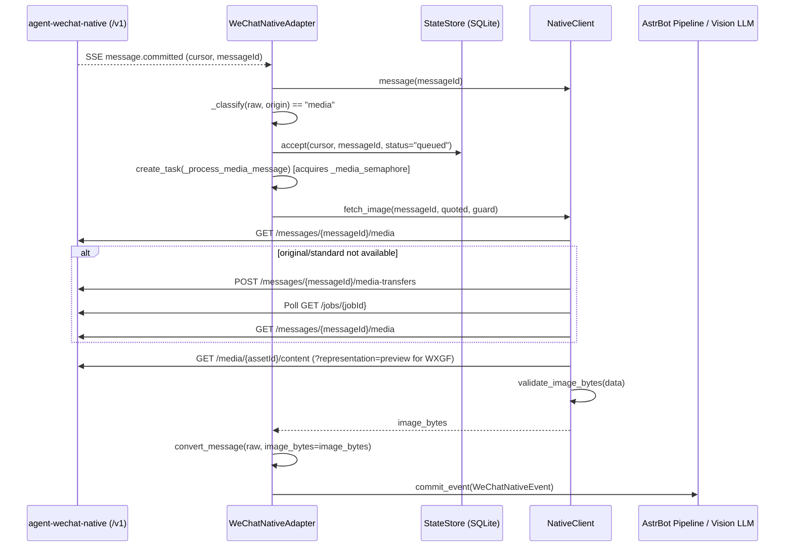

# 图片识别实现说明

[返回 README](../README.md) | [架构说明](architecture.md) | [需求规格书](superpowers/specs/wechat-native-image-recognition.md)

本页说明 `astrbot-plugin-wechat-native` 图片识别功能的触发规则、媒体拉取协议、二进制校验、并发与撤回生命周期及代码落点。

## Overview

图片识别功能通过 `agent-wechat-native v1.3.3` 的 `/v1` 媒体接口，将微信收到的图片拉取到内存、完成格式与完整性校验后，封装为 AstrBot 的 `Image.fromBytes(...)` 组件交给视觉模型分析。

核心设计约束如下：

* **最小配置面**。仅暴露一个布尔开关 `enable_media`（默认 `True`），内部固定单图上限 10 MiB、总超时 60 秒、最大并发下载数 3 以及空提示词兜底文案 `请描述这张图片的内容。`。
* **无落盘与有界内存**。图片字节流在内存中按 64 KiB 分块流式读取，一旦 `Content-Length`、资产元数据或已读字节超过 `MAX_IMAGE_BYTES`（`10 * 1024 * 1024`）立即中断连接，不在插件侧写入临时文件。
* **非阻塞事件流**。SSE 接收循环在调用 `StateStore.accept` 完成去重落库后立即孵化后台任务拉取媒体，慢速图片下载不会阻塞后续纯文本消息处理。
* **撤回联动与安全降级**。在下载前、轮询中、下载后及错误提示发送前全程检查原消息与被引用消息的撤回状态，任何撤回均静默终止且不向微信发送提示。

## 触发矩阵与场景行为

[`WeChatNativeAdapter._classify`](../adapter.py) 将入站实时消息（`origin == "live"`、`direction == "incoming"`、未撤回、非机器人自身发送、时间偏差在 `-60s` 至 `+300s` 内）归类为 `"ignore"`、`"text"` 或 `"media"`。

| 聊天类型 | 消息形式 | Native 消息特征 | 配置要求 | 触发结果与提示词行为 |
| --- | --- | --- | --- | --- |
| 私聊 | 直接发送图片 | `type == 3`，`body` 为空、`None` 或附带文本 | `enable_private_reply=True` 且 `enable_media=True` | 归类为 `"media"` 并立即下载分析。无文本时自动使用 `请描述这张图片的内容。` |
| 私聊 | 引用图片并发送文字 | `type == 49, appMessageType == 57`，`quote.type == 3`，`body` 非空 | `enable_private_reply=True` 且 `enable_media=True` | 归类为 `"media"`，按用户提问结合被引用图片分析 |
| 私聊 | 引用图片或直接发图 | 同上 | `enable_media=False` | 直接发图归类为 `"ignore"`。带文字的引用图片退化为普通 `"text"` 引用文本处理 |
| 群聊 | 直接发送图片 | `type == 3` | 任意模式（含 `mention` 与 `all`） | 始终归类为 `"ignore"`，不下载图片且不回复 |
| 群聊 | 引用图片但未 `@` 机器人 | `type == 49, appMessageType == 57`，`quote.type == 3`，未真实 `@` 机器人 | 任意模式（含 `mention` 与 `all`） | 归类为 `"ignore"`，不触发媒体下载 |
| 群聊 | 引用图片并真正 `@` 机器人 | `type == 49, appMessageType == 57`，`quote.type == 3`，`mentions.state == "known"` 且 `mentions.self is True` | `group_reply_mode` 为 `mention` 或 `all`，且 `enable_media=True` | 归类为 `"media"`。剥离前导 `@昵称\u2005` 后若文本为空，自动使用 `请描述这张图片的内容。` |
| 群聊 | 引用图片并 `@` 机器人发送摘要命令 | 同上，且剥离 `@` 后的文本为 `总结群聊` 或 `群聊摘要` | `group_reply_mode != "disabled"` | 优先归类为 `"text"` 执行群聊摘要，不下载被引用图片 |

## 工作流程

### 1. 去重落库与后台任务调度

在 [`WeChatNativeAdapter.process_native_event`](../adapter.py) 中，当收到 `message.committed` 事件并拉取完整消息后：

1. 调用 `_classify(raw, origin)` 判断消息类别。
2. 调用 `self.state.accept(cursor, message_id, thread, raw.get("serverId"), "queued" if eligible else "ignored")` 在单个 SQLite 事务中记录消息状态并推进 SSE 游标。
3. 若 `fresh` 为真且类别为 `"media"`，先创建占位的 `WeChatNativeEvent` 存入 `self._events[message_id]` 以便响应并发到达的撤回事件，再通过 `asyncio.create_task` 启动 `_process_media_message(raw, wrapped)` 并将任务登记到 `self._media_tasks`。

### 2. Native Media API 变体选择与拉取

[`NativeClient.fetch_image`](../native_client.py) 在 `asyncio.timeout(self.media_timeout)`（60 秒）预算内执行以下步骤：

1. **查询关联媒体资产**。调用 `GET /v1/accounts/{accountId}/messages/{messageId}/media`（[`NativeClient.media_assets`](../native_client.py)）。对于引用图片（`quoted=True`），始终使用当前引用回复消息自身的 Native `id`（`raw["id"]`），绝不使用 `quote["serverId"]`，并过滤 `kind == "image"` 且 `source` 匹配的资产。
2. **优先使用已就绪的高清资产**。若存在 `state == "available"` 且有效变体（`actualVariant` 或 `variant`）为 `"original"` 或 `"standard"` 的资产，按 `original -> standard` 顺序直接下载并校验。
3. **按需发起单次高清传输**。若当前没有已就绪的 `original` 或 `standard` 资产（例如仅缓存了 `thumbnail` 或高清变体处于未下载状态），最多尝试一次高清传输：
   * 若候选资产已携带在途 `jobId`、`activeJobId` 或 `job.id`，直接复用该任务并调用 `GET /v1/accounts/{accountId}/jobs/{jobId}`（[`NativeClient.job`](../native_client.py)）轮询。
   * 否则调用 `POST /v1/accounts/{accountId}/messages/{messageId}/media-transfers`（[`NativeClient.transfer_media`](../native_client.py)）请求下载并轮询至完成（`state` 为 `"available"`、`"completed"` 或 `"succeeded"`），随后重新拉取资产列表下载高清图片。
4. **回退缩略图**。若高清传输不可用或失败（非撤回且非权限缺失），自动回退下载已处于 `state == "available"` 的 `thumbnail` 资产。
5. **处理 `WXGF` 格式**。当资产 `contentType == "image/x-wxgf"` 或 `format == "wxgf"` 时，检查 `asset["preview"]` 元数据并调用 `GET /v1/accounts/{accountId}/media/{assetId}/content?representation=preview` 获取 Native 转码生成的 JPEG 或 PNG 预览图，绝不向 AstrBot 传递原始 `WXGF` 字节。

### 3. 二进制格式与帧结构校验

[`validate_image_bytes`](../native_client.py) 在字节流下载完成后（结合 `byteLength` 与 `sha256` 校验）执行严格的多模态安全检查：

* 拒绝空字节流、超过 `MAX_IMAGE_BYTES` 的载荷、以 `wxgf` 开头的未转码内容以及以 `<` 开头的 HTML/XML 错误页。
* **JPEG** 要求以 `\xff\xd8\xff` 开头，按段长度和扫描数据定位真实的 `\xff\xd9` 结束标记；与 Native 一致，允许结束标记后的附加数据，并保留完整源字节。拒绝截断、段长度越界或仅在元数据内出现结束标记的内容，支持渐进式 JPEG 的多次扫描。
* **PNG** 要求以 `\x89PNG\r\n\x1a\n` 开头、包含合法正整数宽高的 `IHDR` 块且以完整 `IEND` 块结尾。
* **GIF** 要求以 `GIF87a` 或 `GIF89a` 开头、逻辑屏幕宽高大于 0 且以 `;`（`0x3b`）结尾。
* **WebP** 要求符合 `RIFF....WEBP` 容器头、包含 `VP8 `、`VP8L` 或 `VP8X` 块且 `RIFF` 声明长度与实际字节数一致。

### 4. AstrBot 消息组件组装

[`convert_message`](../event.py) 在收到 `image_bytes` 时按以下规则构造 `AstrBotMessage`：

* **提示词归一化**。群聊真实 `@` 机器人时先剥离前导 `@昵称\u2005`。若剩余文本为空白，将 `text` 设为 `DEFAULT_IMAGE_PROMPT`（`"请描述这张图片的内容。"`），同时赋值给 `result.message_str` 与顶层 `Plain(text)`。
* **引用组件占位优化**。当引用图片（`quote.type == 3`）成功解析出 `image_bytes` 时，若 `quote.embeddedText` 非空则保留该文本，否则将 `Reply.message_str` 与 `Reply.chain` 设为 `"[图片]"`，避免出现误导模型的 `"不支持此引用消息的内容"` 或 `"引用消息内容不可用"`。
* **单一顶层图片组件**。仅在 `result.message` 顶层末尾追加一个 `Image.fromBytes(image_bytes)`，不在 `Reply.chain` 内重复塞入 `Image`，防止多模态模型收到重复图像输入。

### 5. 错误映射与撤回联动

[`_map_media_code`](../native_client.py) 与 [`MEDIA_ERROR_MESSAGES`](../native_client.py) 将所有异常收敛为固定用户提示，由 `_process_media_message` 调用 `self.send_chain` 发送：

| 内部原因标识 | 触发条件 | 用户侧行为 |
| --- | --- | --- |
| `"recalled"` | 原消息或被引用图片撤回、HTTP `410 message_recalled`、资产状态为 `recalled` | 静默终止事件，不调用模型，不发送任何错误提示 |
| `"expired"` | 引用图片 `quote.state != "embedded"`、`embeddedImage` 非真、`media_expired` 或引用媒体 `404` | 回复 `引用的图片已失效，请重新发送。` |
| `"too_large"` | HTTP `413`、`image_size_limit`、`source_size_limit`、`wxgf_preview_limit` 或字节数超过 10 MiB | 回复 `图片太大，暂时无法处理。` |
| `"missing_scope"` | HTTP `401/403`、`unauthorized`、`forbidden` 或 `insufficient_scope` | 回复 `图片读取功能未正确配置，请联系管理员。` |
| `"unsupported_format"` | `quote.state == "unsupported"`、`wxgf` 无可用预览、不支持的加密/封装或非 JPEG/PNG/GIF/WebP 格式 | 回复 `暂不支持这种图片格式。` |
| `"unavailable"` | 下载超时、网络断开、散列不匹配、图片截断损坏或其他媒体拉取失败 | 回复 `图片无法读取，请重新发送。` |

若插件正在停机（`WeChatNativeAdapter._terminate`）取消了在途媒体下载任务，且消息状态仍为 `queued`，适配器会将其标记为 `needs_review` 保留现场。

## 代码落点

* [`config.py`](../config.py) 定义 `enable_media` 配置项及 `MAX_IMAGE_BYTES`、`MEDIA_DOWNLOAD_TIMEOUT`、`MAX_CONCURRENT_MEDIA_TASKS`、`DEFAULT_IMAGE_PROMPT` 四个内部常量。
* [`native_client.py`](../native_client.py) 定义 `MediaError`、`MEDIA_ERROR_MESSAGES`、`validate_image_bytes`、`_map_media_code` 以及 `NativeClient` 的 `media_assets`、`transfer_media`、`job`、`media_content` 和 `fetch_image`。
* [`event.py`](../event.py) 在 `convert_message` 中处理默认提示词注入、引用图片 `[图片]` 摘要占位和顶层 `Image.fromBytes(image_bytes)` 挂载。
* [`adapter.py`](../adapter.py) 在 `WeChatNativeAdapter` 中实现 `_classify`、`_process_media_message`、`_media_semaphore` 并发控制、撤回取消与停机清理。
* 测试覆盖位于 [`tests/test_config_state.py`](../tests/test_config_state.py)、[`tests/test_native_client.py`](../tests/test_native_client.py)、[`tests/test_adapter.py`](../tests/test_adapter.py) 和 [`tests/test_quotes.py`](../tests/test_quotes.py)。
